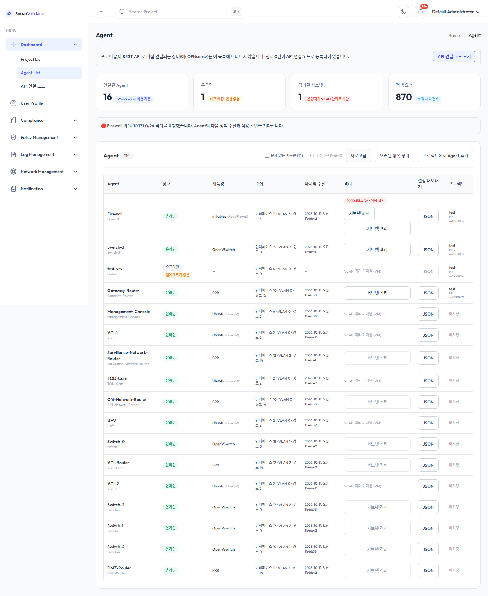
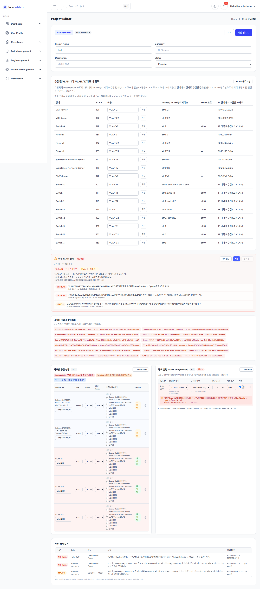
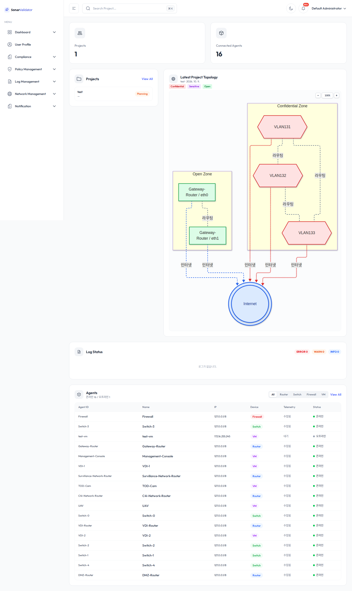
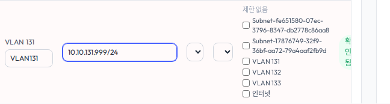
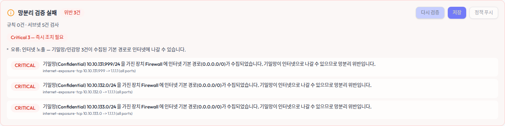
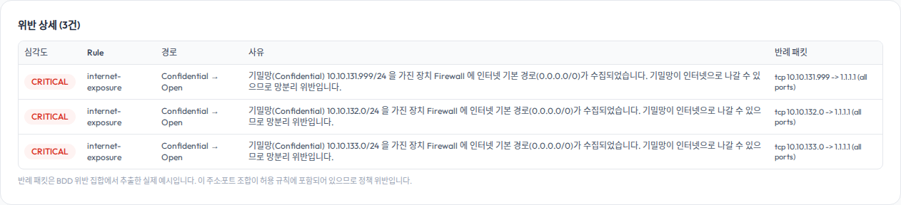

# SonarValidator 전체 기능 검증 보고서 (2026-10-10, 2026-10-11 보완)

## 1. 요약

| 항목 | 결과 |
|---|---|
| 실행 방식 | `SONAR_POLICY_AUTOMATIC_ENFORCEMENT_ENABLED=false ./Test/dev.sh --no-debug` |
| Frontend | `http://localhost:5173` (Vite dev) — HTTP 200 |
| Backend | `http://localhost:3000` (Spring Boot, H2 `local`) — actuator health `UP` |
| 정적·단위 회귀 | Backend 441/441, Frontend 3/3, Prober 23/23 통과 |
| 화면 회귀 | 15개 라우트 모두 렌더링, page error 0 |
| VLAN 등급 영속성 | VLAN 131·132·133 = `Confidential` 저장 후 유지 |
| 정책 푸시 안전장치 | 위반 존재 시 **버튼 비활성화** (`위반이 있어 전송할 수 없습니다`) |
| **격리 정책 실측** | **PASS** — VLAN 131 단독 차단, VLAN 132 영향 없음, 해제 후 완전 복구 |
| CIDR 부정 입력 | **FAIL** — 잘못된 입력 4/4를 HTTP 200으로 처리하고 원문 재사용 |
| 활성 격리 (종료 시) | 0건 |
| 최종 판정 | **조건부 실패 — 핵심 격리 기능은 통과했으나 High 입력 검증 버그 재현** |

> **2차 검증(§10) 추가**: `dev.sh` 의 `.env` 로더를 수정하고, 터미널 3종·격리 왕복 재확인,
> 3등급(Confidential/Sensitive/Open) 설정과 연결 규칙으로 위반 발생→해소까지 검증했다. (16/16 PASS)

> **3차 보완 검증(§11) 추가**: 공식 전체 회귀와 Frontend Node 테스트를 재실행했고,
> `BUG-CIDR-VALIDATION-001`이 현재 코드에서도 4/4 재현됨을 확인했다.

> 격리 실측은 프론트엔드 UI 로 요청하고, 실제 차단 효과는 Firewall Agent **터미널에서 ping** 으로 교차 확인했다.

## 2. 실행 환경

- 호스트: Management-Console `172.16.255.245` (osboxes)
- 테스트 프로젝트: `PRJ-AADE1BC3` (`test`) — VLAN 131·132·133 (`10.10.131.0/24` ~ `10.10.133.0/24`) 보유
- 로그인: `admin` / `.env` 의 `SONAR_ADMIN_PASSWORD`
- 정책 자동 적용은 검증 중 대상 외 장비로 전파되지 않도록 **꺼짐**(`false`)으로 기동

### 검증 중 발견한 환경 특이사항 (테스트 방법론에 반영)

1. **CORS**: `Test/dev.sh` 는 `.env` 의 `SONAR_CORS_ALLOWED_ORIGINS` 를 export 하지 않는다.
   따라서 백엔드는 기본 허용 목록(`localhost:5173`)만 신뢰한다. 브라우저 검증은 반드시
   `http://localhost:5173` 으로 접속해야 하며, `http://172.16.255.245:5173` 로 접속하면
   로그인 요청이 CORS 로 막혀 `백엔드에 연결할 수 없습니다` 오류가 난다.
2. **터미널 에코**: Agent 터미널은 입력한 명령을 그대로 되돌려 출력한다. 완료 마커를
   `includes()` 로 찾으면 에코된 명령 문자열에 먼저 걸린다. 독립된 출력 줄 정규식
   (`^TABLE_PRESENT$`)으로 판정해야 한다.
3. **터미널 WebSocket 일시 거절**: 첫 접속 시 `Agent terminal is offline or not configured
   with the shared secret` 로 거절되는 경우가 있다(재시도하면 정상). 터미널 단계는 재시도를
   넣어야 안정적이다.

## 3. 단계별 결과

| 단계 | 검증 항목 | 결과 | 증거 |
|---|---|:--:|---|
| A | 로그인/인증 (`/auth/me` 200) | PASS | `evidence/steps-progress.json` |
| B | 화면 회귀 15개 라우트 + 스크린샷 | PASS | `screenshots/01~15` |
| C | VLAN 131/132/133 = Confidential 저장·유지 | PASS | `evidence/result.json` |
| C2 | 정책 안전장치(푸시 버튼 가드) | PASS | `screenshots/18-policy-push.png` |
| D | 격리 전 기준 통신 (131·132 도달) | PASS | `evidence/terminal-baseline-recheck.txt` |
| D2 | Firewall `10.10.131.0/24` 격리 요청 → `applied=true` | PASS | `screenshots/20·21` |
| D3 | 격리 실측 (131 차단, 132 유지) | PASS | `evidence/terminal-isolation-proof.txt` |
| D4 | 격리 해제 요청 | PASS | `screenshots/22-quarantine-released.png` |
| D5 | 해제 복구 실측 (테이블 제거, 131·132 도달) | PASS | `evidence/terminal-recovery-proof.txt` |
| E | 최종 상태 (등급 유지, 활성 격리 0) | PASS | `evidence/baseline-recheck.json` |

## 4. 격리 정책 실측 (핵심)

모든 확인은 Firewall Agent 터미널에서 `ping -c 2 -W 1` 의 반환 코드로 판정했다.

### 4.1 격리 전 (기준)

```
TABLE_ABSENT
BASELINE_131=0 BASELINE_132=0
```

- nft 격리 테이블 없음, 두 서브넷 모두 도달(`rc=0`).

### 4.2 격리 적용

프론트 `/agent` → Firewall 행 → `서브넷 격리` → `VLAN131` 선택 → `선택한 서브넷 격리`.

- HTTP 200, 응답 상태:

```json
{
  "agent_id": "Firewall", "scope": "CONNECTION", "target_cidr": "10.10.131.0/24",
  "applied": true, "applied_detail": "nft IPv4 subnet quarantine reconciled"
}
```

### 4.3 격리 중 (차단 실측)

```
TABLE_PRESENT
ping: sendto: Operation not permitted
ISOLATED_131=1 UNAFFECTED_132=0
```

- VLAN 131 은 **차단**(`rc=1`), VLAN 132 는 **정상**(`rc=0`) — 대상 단독 격리 확인.



### 4.4 격리 해제 후 (복구 실측)

```
QUARANTINE_TABLE_REMOVED
RECOVERED_131=0 RECOVERED_132=0
```

- nft 격리 테이블 제거, 두 서브넷 모두 도달 복구.

### 4.5 종료 시 활성 격리

`GET /api/v1/quarantine?project_id=PRJ-AADE1BC3` → `total = 0`.

## 5. 화면 캡처

`Report-20261010/screenshots/` (총 29장)

| 파일 | 화면 |
|---|---|
| `00-after-login.png` | 로그인 직후 대시보드 |
| `01-dashboard.png` ~ `15-profile.png` | 15개 주요 라우트 회귀 |
| `16-three-vlans-confidential-draft.png` | 3개 VLAN 등급 편집 |
| `17-confidential-saved-validation.png` | 저장·망분리 검증 결과 |
| `18-policy-push.png` | 정책 푸시 안전장치 |
| `19-agent-before-quarantine.png` | 격리 전 Agent 목록 |
| `20-quarantine-modal-selected.png` | VLAN131 선택 |
| `21-quarantine-applied.png` | 격리 적용 확인 |
| `22-quarantine-released.png` | 격리 해제 |
| `23-final-subnet-state.png`, `24-final-state-recheck.png` | 최종 상태 |
| `terminal-isolation-proof.png` | 격리 중 터미널(ping 차단) |
| `terminal-recovery-proof.png` | 복구 후 터미널 |
| `99-fail-D-baseline-reachability.png` | (참고) 터미널 일시 거절 장면 |

## 6. 관찰 사항 및 개선 제안

1. **`dev.sh` 의 `.env` 미로드 — ✅ 해결됨 (2차 검증에서 수정)**
   `Test/dev.sh` 에 `.env` 로더를 추가했다. 자세한 내용은 아래 "10. 2차 검증" 참고.
   단, `.env` 의 `VITE_API_BASE_URL=`(빈 값)·`FRONTEND_PORT=80`/`BACKEND_PORT=3000`(docker 용)은
   dev 환경과 충돌하므로 로더에서 제외한다.

2. **터미널 접속 일시 거절 (재시도 UI 필요)**
   첫 `터미널 열기` 시 `Agent terminal is offline or not configured with the shared secret`
   로 실패하는 사례가 있었다. 사용자에게 `다시 시도` 를 제공하거나 자동 재시도를 권장.

3. **터미널 에코로 인한 마커 오검출 (테스트 도구 한정)**
   Agent 터미널은 입력을 에코하므로 자동화 판정 시 독립 출력 줄만 검사해야 한다.
   (본 보고서의 증적은 이 규칙으로 보정함 — `baseline-recheck.json` 참고)

4. **CIDR 입력 검증 결함 — ❌ 3차 검증에서 재현**
   `BUG-CIDR-VALIDATION-001`은 현재 코드에서도 재현됐다. 잘못된 CIDR 4종 모두 초안 검증이
   HTTP 200을 반환했고, 오류 표시는 없었으며 잘못된 원문을 위반 응답에 다시 포함했다.
   저장 API는 호출하지 않아 영속 CIDR은 `10.10.131.0/24`로 유지됐다. 자세한 결과는 §11 참고.

## 7. 산출물

- 계획: `Report-20261010/PLAN.md`
- 결과: `Report-20261010/REPORT.md` (본 문서)
- 증적: `Report-20261010/evidence/` (JSON·터미널 원문)
- 캡처: `Report-20261010/screenshots/` (29장)
- 로그: `Report-20261010/logs/`
- 스크립트: `Report-20261010/scripts/{full-e2e.mjs, recheck-baseline.mjs}`
- 3차 증적: `Report-20261010/evidence/round3/`
- 3차 스크립트: `Report-20261010/scripts/round3-regression.mjs`

### 주요 증적 파일

| 파일 | 내용 |
|---|---|
| `evidence/result.json` | 전체 단계/스크린샷/브라우저 오류 |
| `evidence/steps-progress.json` | 단계별 진행 상태 |
| `evidence/terminal-isolation-proof.txt` | 격리 중 ping 원문 |
| `evidence/terminal-recovery-proof.txt` | 복구 후 ping 원문 |
| `evidence/terminal-baseline-recheck.txt` | 격리 전 기준 통신 원문 |
| `evidence/baseline-recheck.json` | 최종 상태 재확인 |

## 8. 최종 상태

- VLAN 131·132·133: `Confidential` 유지
- 활성 격리: **0건**
- Agent: 16 connected / 17 total
- 백엔드 health: `UP` (200), 프론트엔드: 200
- 3차 검증용 dev 스택: 검증 완료 후 정상 종료

## 9. 판정

**조건부 실패(CONDITIONAL FAIL).** 격리 정책의 실제 차단·무영향·복구 라운드트립과
정적·단위 회귀는 통과했다. 그러나 High 등급의 `BUG-CIDR-VALIDATION-001`이 3차 검증에서도
4/4 재현되어 “전체 기능 정상”으로 판정할 수 없다. CIDR 입력 경계에서 잘못된 주소를
명시적으로 거부하고 회귀 테스트를 추가한 뒤 최종 PASS로 전환해야 한다.

---

# 10. 2차 검증 (2026-10-10, 후속 요청)

## 10.1 수정한 것 — `Test/dev.sh` 의 `.env` 로더

기존 `dev.sh` 는 `.env` 를 전혀 읽지 않아 백엔드가 기본 CORS(`localhost:5173`)만 허용했고,
관리 콘솔 IP(`172.16.255.245:5173`)로 접속하면 로그인이 CORS 로 막혔다.

`load_env_file()` 을 추가해 루트 `.env` 를 환경변수로 로드하도록 했다.

- 이미 설정된 변수는 덮어쓰지 않는다(명령줄 override 우선).
- dev.sh 가 관리하는 `BACKEND_PORT`/`FRONTEND_PORT`/`DEBUG_PORT` 는 `.env`(docker 용 80/3000)로 덮지 않는다.
- **`VITE_*` 도 제외**한다. `.env` 의 `VITE_API_BASE_URL=`(빈 값)은 nginx 프록시용이라,
  dev(Vite :5173)에서 상대경로 요청 → 404 가 된다. 프론트는 기본값(`http://<host>:3000`)을 쓴다.
- `--no-env` 로 로더를 건너뛸 수 있다.

### 검증

- 로더 단위 테스트(`scripts/test-env-loader.sh`): 포트 미덮어쓰기·명령줄 우선·CORS 로드·VITE 제외 확인
- CORS 프리플라이트(`Origin: http://172.16.255.245:5173`) → `Access-Control-Allow-Origin` 반환
- 브라우저 로그인(`http://172.16.255.245:5173`) 성공 → `/auth/me` 200

## 10.2 2차 테스트 매트릭스 결과 (16/16 PASS)

| 단계 | 검증 항목 | 결과 | 증거 |
|---|---|:--:|---|
| A | 로그인 (관리 콘솔 IP, 수정된 CORS) | PASS | `round2/A-01-dashboard.png` |
| B1 | 터미널 — Firewall | PASS | `terminal-firewall.png` |
| B2 | 터미널 — Gateway-Router (vtysh→shell) | PASS | `terminal-router.png` |
| B3 | 터미널 — Switch-3 | PASS | `terminal-switch.png` |
| C1 | 격리 전 기준 통신 | PASS | `terminal-iso-baseline.png` |
| C2 | VLAN131 격리 요청 → `applied=true` | PASS | `C-03-quarantine-applied.png` |
| C3 | 격리 실측 (131 차단·132 유지) | PASS | `terminal-iso-applied.png` |
| C4 | 격리 해제 | PASS | `C-04-released.png` |
| C5 | 복구 실측 (131·132 도달) | PASS | `terminal-iso-recovered.png` |
| D0 | 기존 규칙 정리 | PASS | — |
| D | 등급 131=Conf, 132=Open, 133=Sens 저장·유지 | PASS | `D-02-grades-saved.png` |
| E | 금지쌍 규칙(131→132) → 검증 실패 | PASS | `E-02-forbidden-rule-result.png` |
| F | Sensitive 경유(131→133→132) → 등급 위반 해소 | PASS | `F-02-via-sensitive-result.png` |
| G | 원복 (등급 Confidential, 규칙 0) | PASS | `G-02-restore-result.png` |
| H | 최종 (활성 격리 0, Agent 16/17) | PASS | `H-01-final.png` |

## 10.3 터미널 실측 (B)

| 장비 | 실행 | 결과 |
|---|---|---|
| Firewall | `id; hostname` | `uid=0(root)`, `TERM_FW_222` |
| Gateway-Router | vtysh → `show ip route` → `exit` → shell | shell 프롬프트 `frr:/#`, `8888888`, `TERM_RT_444` |
| Switch-3 | `id` | `TERM_SW_666` (root) |

> 라우터는 로그인 프로필이 vtysh 를 `less` pager 로 띄우므로, pager 를 걷어내고 paging 을 끈 뒤
> `exit` 으로 shell 로 빠져나와야 명령이 실행된다. (vtysh 는 입력을 에코하므로 산술 결과 `8888888` 로 shell 여부 판정)

## 10.4 격리 정책 실측 (C) — 재확인

| 단계 | Firewall 터미널 | API |
|---|---|---|
| 격리 전 | `BASE_131=0 BASE_132=0` | — |
| 격리 중 | `ISO_131=1 UNAFF_132=0` | `applied=true` (`nft IPv4 subnet quarantine reconciled`) |
| 해제 후 | `REC_131=0 REC_132=0` | 활성 격리 0 |

→ VLAN 131 단독 차단, VLAN 132 무영향, 해제 시 완전 복구. (1차와 동일 결과 재현)

## 10.5 등급 + 연결 규칙 검증 (D·E·F) — "왜 위반이고 어떻게 해소하는가"

**서버 등급 규칙**: `|등급 차이| ≤ 1` 이면 직접 연결 허용, `≥ 2` 면 금지.
위반 = **연결 규칙(허용 집합)** ∩ **금지쌍 집합**.

### D. 3등급 설정 (영속성 확인)
`131=Confidential(3)`, `132=Open(1)`, `133=Sensitive(2)` 저장 → 새로고침 후 유지.

### E. 금지쌍 규칙 추가 → 위반 (FAIL 의도)
`Rule-0001: 131(Confidential) → 132(Open) :443` 저장·검증 →

```
CRITICAL: VLAN131 (10.10.131.0/24) -> VLAN132 (10.10.132.0/24) 연결은 허용되지 않습니다.
          (Confidential ↔ Open — 등급 2단계 차이)
```

→ 등급을 건너뛰는 연결이 정확히 CRITICAL 위반으로 탐지됨. (위반 3건 중 1건이 이 규칙)

### F. Sensitive 경유로 해소 → 통과
`Rule-0001` 을 `131(Confidential) → 133(Sensitive)` 로 바꾸고 `Rule-0002: 133(Sensitive) → 132(Open)` 추가 →

- 규칙 기반(등급 건너뛰기) 위반: **1건 → 0건** (해소)
- 남은 위반은 이 규칙과 무관한 것들뿐:
  - `CRITICAL: 기밀망 10.10.131.0/24 (Firewall) 인터넷 기본 경로 노출`
  - `MAJOR: 민감망 10.10.133.0/24 (Firewall) 인터넷 기본 경로 노출`
- `forbidden-pairs` 는 **6쌍 그대로**(131↔132 포함) → 등급 규칙은 약화되지 않았고, 해소는
  **규칙을 Sensitive 경유로 설계**해서 이뤄졌음을 확인.

> 즉 **"연결 규칙을 제대로(금지쌍을 직접 잇지 않고 Sensitive 를 경유하도록) 추가"** 하면
> 등급 위반이 해소된다. 인터넷 노출은 장치(Firewall)에 `0.0.0.0/0` 기본 경로가 수집된
> 랩 고유 조건이라 연결 규칙만으로는 사라지지 않는다(정책/장치 설정 문제).



### G·H. 원복·최종
- 등급 131·132·133 = Confidential, 규칙 0건으로 원복
- 활성 격리 0건, Agent 16/17 연결

## 10.6 2차 산출물

| 경로 | 내용 |
|---|---|
| `screenshots/round2/` | 20장 (로그인·터미널 6·격리 4·등급 2·규칙 4·원복 2·최종 1) |
| `evidence/round2/result.json` | 전체 단계/스크린샷/브라우저 오류 |
| `evidence/round2/terminal-*.txt` | 터미널 원문 6건 |
| `scripts/round2.mjs` | 2차 검증 스크립트 |
| `scripts/test-env-loader.sh` | `.env` 로더 단위 테스트 |
| `logs/{dev-stack-3,env-loader-test,round2}.log` | 실행 로그 |

## 10.7 2차 판정

**통과(PASS, 16/16).** `dev.sh` 의 `.env` 미로드 문제를 수정했고(관리 콘솔 IP 로그인 정상화),
터미널 3종·격리 왕복·3등급 설정·금지 규칙 위반·Sensitive 경유 해소를 모두 확인했다.
**연결 규칙을 Sensitive 경유로 설계하면 등급 위반이 해소된다**는 점이 실측으로 증명되었다.

---

# 11. 3차 보완 검증 (2026-10-11)

## 11.1 결과 요약

| 영역 | 결과 | 세부 결과 |
|---|:--:|---|
| Backend 전체 테스트 | PASS | 441/441, failure/error/skip 0 |
| Frontend Node 테스트 | PASS | 3/3 |
| Frontend type-check | PASS | `tsc -b` 성공 |
| Frontend lint | PASS (경고) | error 0, `react-refresh` 경고 7 |
| Frontend production build | PASS (경고) | 빌드 성공, CSS minify 경고 3 및 대형 chunk 경고 |
| Prober CTest | PASS | 23/23 |
| Agent Bundle | PASS | 바이너리·설치 스크립트·서비스 자산 검증 |
| Docker Compose | PASS | `config --quiet` 성공 |
| `.env` 로더 | PASS | 포트/VITE 제외, override 우선, CORS·비밀값 로드 확인 |
| Backend health | PASS | HTTP 200, `UP` |
| 관리 콘솔 CORS | PASS | `Access-Control-Allow-Origin: http://172.16.255.245:5173` |
| 인증 가드/로그인 | PASS | `/agent` → `/signin`, `/auth/me` 200 ADMIN |
| CIDR 부정 입력 | **FAIL** | 4/4 HTTP 200, 입력 오류 없음, 원문 재사용 |
| 영속성/안전 상태 | PASS | CIDR 불변, 활성 격리 0건 |

공식 전체 검사 명령 `./Test/test.sh --all --no-install`은 exit code 0으로 완료됐다.
이 스크립트에 포함되지 않은 `npm test`도 별도로 실행해 3/3 통과를 확인했다.

## 11.2 CIDR 부정 입력 재현

| 입력 | 의도 | HTTP | 오류 표시 | 응답 원문 재사용 | 결과 |
|---|---|---:|:--:|:--:|:--:|
| `10.10.131.999/24` | 옥텟 범위 초과 | 200 | 없음 | 있음 | FAIL |
| `10.10.131.0/33` | prefix 범위 초과 | 200 | 없음 | 있음 | FAIL |
| `10.10.131/24` | 옥텟 누락 | 200 | 없음 | 있음 | FAIL |
| `not-an-ip/24` | 비수치 주소 | 200 | 없음 | 있음 | FAIL |

네 입력 모두 `violation_count=3`인 일반 정책 검증 결과로 처리됐다. 즉 서버는 CIDR 파싱 오류를
입력 오류로 돌려주지 않고 후속 정책 판정까지 진행한다. 이 동작은 잘못된 CIDR이 저장 또는
정책 생성 경로로 흘러갈 위험이 있어 High 결함 판정을 유지한다.

테스트는 초안 검증만 호출했으며 저장 API는 호출하지 않았다. 검증 전후 VLAN 131 CIDR은
`10.10.131.0/24`로 동일했고 활성 격리는 0건이었다.

## 11.3 권장 수정 및 합격 기준

1. Backend의 저장·초안 검증 공통 경계에서 `PacketVariables.parseCidr`로 모든 CIDR을 검증한다.
2. 실패 시 HTTP 400 또는 구조화된 `invalid-cidr` 위반을 반환하고 잘못된 원문으로 정책 판정을 계속하지 않는다.
3. Frontend CIDR 입력에도 행 단위 오류 문구를 표시하고 저장·검증 버튼을 차단한다.
4. 위 4개 부정 입력과 정상 `/0`, `/32`, 네트워크 정규화 사례를 자동 회귀 테스트에 추가한다.

최종 PASS 전환 기준은 부정 입력 4/4 거부, 정상 경계값 수락, 저장 상태 불변, 전체 회귀 유지다.

## 11.4 증적

| 경로 | 내용 |
|---|---|
| `evidence/round3/regression-summary.json` | 정적·단위·빌드 회귀 합계와 경고 |
| `evidence/round3/result.json` | health/CORS/인증/CIDR 4종/최종 안전 상태 원문 |
| `screenshots/round3/invalid-cidr-draft.png` | 저장 전 잘못된 CIDR 초안 화면 |
| `scripts/round3-regression.mjs` | 읽기 전용·비저장 3차 브라우저/API 검증 스크립트 |

---

# 12. Frontend 화면 증적 및 오류 해결안 (2026-10-11)

## 12.1 실행·캡처 결과

Frontend와 Backend를 다시 기동해 실제 데이터가 표시되는 상태에서 캡처했다.

- Frontend: `http://172.16.255.245:5173` — 실행 중
- Backend: `http://172.16.255.245:3000` — health `UP`
- Dashboard: 프로젝트 1건, 연결 Agent 16대 표시
- 캡처 중 page error: 0건
- CIDR 초안 검증 응답: HTTP 200
- 잘못된 입력 원문 재사용: `true`
- CIDR 입력 오류 표시: `false`









## 12.2 해결 우선순위

| 우선순위 | 문제 | 원인 | 권장 해결 |
|---:|---|---|---|
| P0 | 잘못된 CIDR 수락 | 파서는 예외를 내지만 `normalizeCidr()`가 예외를 삼키고 원문을 반환 | 저장 경계는 400 거부, 초안 검증은 `invalid-cidr` 위반 반환 |
| P1 | CSS minify 경고 3건 | pseudo-element 안의 Tailwind `dark:` variant가 빈 `:is()` 생성 | `dark:`를 `@apply`에서 제거하고 기존 `.dark ...` 명시 규칙 사용 |
| P1 | main chunk 2.34 MB | `App.tsx`가 모든 페이지와 Mermaid/ApexCharts 경로를 정적 import | route-level `React.lazy`, Mermaid 지연 import, 필요 시 vendor chunk 분리 |
| P2 | Fast Refresh lint 경고 7건 | 컴포넌트 파일에서 hook·배열 상수 등을 함께 export | Provider/컴포넌트와 hook·상수 모듈 분리 |
| P2 | Hibernate ordering 경고 | `mappedBy` inverse 컬렉션에 `@OrderColumn` 사용 | 명시적 `ordinal` 필드 + `@OrderBy`, 저장 시 순번 부여 |
| P3 | ANTLR unreachable token 경고 | `dynamic`, `type`, `comment` 문자열이 여러 lexer token에 중복 | 공통 token으로 합치고 parser context에서 재사용 |
| 운영 | Git object 손상 | `.git/objects`에 빈 object 119개 존재 | 새 clone에 작업 파일을 이관하는 방식으로 복구 |

## 12.3 `BUG-CIDR-VALIDATION-001` 수정 설계

### Backend

현재 `PacketVariables.parseCidr()`는 옥텟과 prefix 범위를 정상적으로 검사한다. 문제는
`PolicySubnet.normalizeCidr()`가 `IllegalArgumentException`을 잡은 뒤 잘못된 원문을 그대로
반환하고, `SegmentationBddEngine.validate()`가 빈 문자열 여부만 확인한 채 그 값을 색인하는 데 있다.

권장 동작은 다음과 같다.

1. `ProjectService`의 DTO→도메인 변환 직후 모든 비어 있지 않은 CIDR에 `parseCidr()`를 적용한다.
2. 저장/수정 API에서는 파싱 실패를 HTTP 400 `invalid-cidr`로 반환해 DB 유입을 차단한다.
3. 초안 검증에서는 전체 요청을 400으로 끝내거나, `rule_id=invalid-cidr`인 구조화된 위반을 반환한다.
4. 잘못된 서브넷은 `byCidr`, BDD, 인터넷 노출 검사에서 제외해 가짜 반례를 만들지 않는다.
5. 관대한 정규화가 필요한 수집 경로는 `tryNormalizeCidr()`처럼 이름과 반환형을 분리한다.

### Frontend

1. `lib/policy/cidr.ts`에 순수 함수 `validateIpv4Cidr()`를 둔다.
2. `ProjectEditor`가 `subnetId → 오류 문구` 맵을 계산해 `SubnetEditor`에 전달한다.
3. 입력에 `aria-invalid`, 오류 테두리, `유효한 IPv4 CIDR을 입력하세요` 문구를 표시한다.
4. 입력 오류가 하나라도 있으면 `검증 실행`·`저장 및 검증`을 비활성화한다.
5. 서버의 `invalid-cidr` 응답도 같은 행 오류로 매핑해 클라이언트 검증 우회를 막는다.

회귀 테스트에는 기존 4개 실패 입력 외에 `/0`, `/32`, `10.10.131.7/24`의
`10.10.131.0/24` 정규화와 `10.0.0.1/24/extra` 같은 다중 slash 입력을 포함해야 한다.

## 12.4 Frontend 경고별 구체적 수정

### CSS minify

- `index.css`의 `.custom-scrollbar::-webkit-scrollbar-thumb`에서
  `@apply ... dark:bg-gray-700`의 `dark:`를 제거한다.
- `.simplebar-scrollbar::before`의 `dark:!bg-gray-700`도 제거한다.
- 두 selector 모두 바로 아래에 이미 `.dark ...` 명시 규칙이 있으므로 화면 동작은 유지된다.
- 수정 후 `npm run build`에서 `Unexpected ")"` 경고가 0건인지 확인한다.

### Fast Refresh lint

- `AgentDeployCard.tsx`의 `AGENT_DEVICE_TYPES`를 `agentDeviceTypes.ts`로 이동한다.
- `AuthContext`, `ProjectWizardContext`, `SidebarContext`, `ThemeContext`의 hook을 각각 별도
  `use*.ts` 모듈로 분리하고 Provider 파일은 컴포넌트만 export한다.
- `Branch_Divider`는 `BranchDivider`로 이름을 정규화하고 default export 하나만 유지한다.
- 규칙을 끄는 것보다 모듈을 분리해야 개발 중 Hot Reload 상태 보존도 확실해진다.

### 번들 크기

- `App.tsx`의 페이지 정적 import를 `lazy(() => import(...))`로 바꾸고 `<Suspense>`로 감싼다.
- `lib/mermaid.ts`의 최상위 `import mermaid`를 최초 렌더 시 동적 import하고 초기화 결과를 캐시한다.
- 차트가 있는 Dashboard/샘플 페이지도 route chunk로 분리한다.
- 그 뒤에도 공용 vendor가 크면 Vite `manualChunks`를 적용한다. 먼저 route lazy를 적용해야
  실제 사용 경로 기준으로 분리가 되어 단순한 vendor 쪼개기보다 효과가 크다.

## 12.5 Backend·저장소 경고

- Hibernate: `Project.subnets/rules`의 `@OrderColumn`을 제거하고 자식 entity에 명시적
  `ordinal`을 매핑한 뒤 `@OrderBy("ordinal ASC")`를 사용한다.
- ANTLR: `dynamic`은 `ADDRFLAG`와 `ARPTYPE`, `type/comment`는 `ATTRKEY`와 다른 token이
  겹친다. 공통 token으로 정의하고 parser rule 양쪽에서 허용한 뒤 parser 회귀 테스트를 실행한다.
- Git: 빈 object를 바로 삭제하거나 `git gc`를 실행하면 복구 불가능한 로컬 object까지 잃을 수 있다.
  현재 작업 폴더를 별도 백업하고 `origin`에서 새 clone을 만든 다음 변경 파일을 이관하는 방법이 가장 안전하다.

## 12.6 추가 증적

| 경로 | 내용 |
|---|---|
| `evidence/round3/error-screenshots.json` | 캡처 완료 여부, HTTP 상태, 화면 오류 표시 여부 |
| `screenshots/round3/errors/` | Dashboard·입력·검증 요약·위반 상세 4장 |
| `scripts/capture-error-screenshots.mjs` | 화면 증적 재생성 스크립트 |

