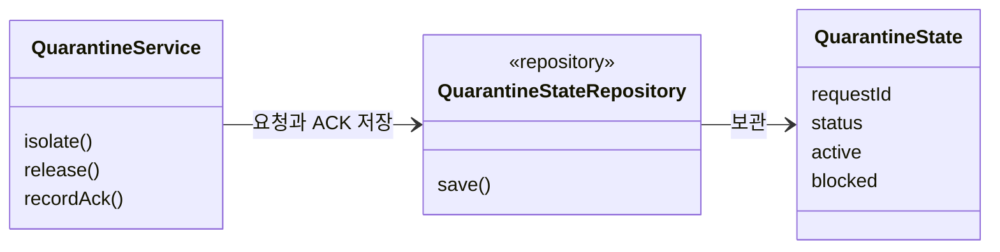
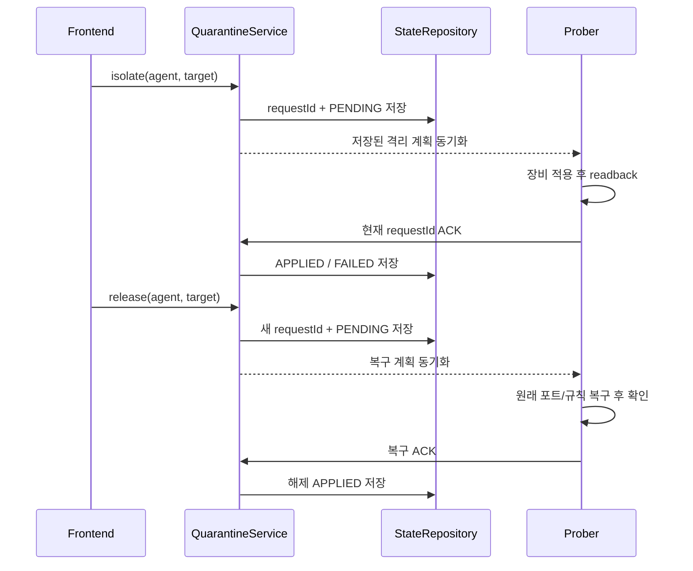
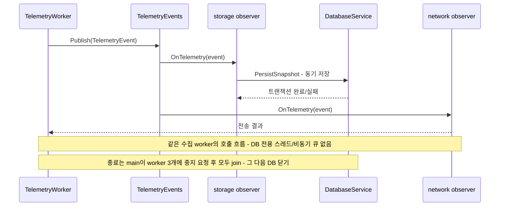
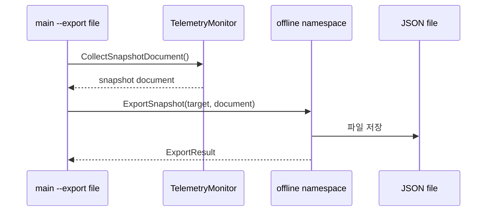

# 핵심 기능 UML - 발표용 발췌

이 문서는 **현재 코드의 일부 클래스와 호출만 발췌한 UML**입니다. 전체 클래스·모든 메서드·예외 처리를 표시하지 않습니다. 격리 관리, 단일 파일 출력 진입점, 수집 완료 이벤트와 종료 순서에 집중합니다. 장비별 상세 전략은 [전체 장비 확장 구조](device-extensions.md), 자원 소유권은 [Prober 실행 구조](prober-runtime.md)를 참고합니다.

## 1. 격리 관리의 주요 클래스

API 요청 수신과 실제 장비 적용을 구분합니다. `PENDING / APPLIED / FAILED`, 현재 요청 ID, 마지막으로 확인한 차단 상태를 보존합니다. release 요청만 보냈다고 복구 완료로 표시하지 않습니다.

## 2. 격리 요청과 복구 확인

새 요청과 다른 ACK는 반영하지 않습니다. 관리 경로는 격리 대상에서 제외하고 실제 데이터 패킷 차단·복구는 Robot이 별도로 확인합니다. API-only OPNsense 격리는 현재 지원하지 않습니다.

## 3. 수집 이벤트와 DB 저장 및 종료

현재 main + 수집·관리·터미널 worker 3개입니다. 이벤트 기반은 수집 완료 시 구독자를 호출한다는 뜻이며 새 스레드나 비동기 메시지 브로커가 아닙니다. DB는 mutex 하나로 저장과 Close를 직렬화합니다. 여러 테이블 전체의 원자적 스냅샷은 아직 구현하지 않았습니다.

DB 전용 스레드·큐의 종료 조율을 제거하고, worker와 PTY/셸 자원의 소유권을 명확히 했습니다. 소켓 I/O의 취소·제한 시간, 셸 종료 후 잔여 작업 회수와 join 순서를 통해 종료 대기와 hang을 유발하던 경로를 개선했습니다. `sigterm_shutdown_test`, `terminal_worker_test`, `websocket_timeout_test`, `websocket_reconnect_test` 및 실제 터미널 회귀로 확인했습니다. 이벤트 방식 자체가 모든 hang을 없앤다는 뜻은 아닙니다. 셸 프로그램은 posix_spawn으로 여전히 OS 프로세스를 생성합니다.

## 4. 파일 출력의 단일 진입점

실제 파일 기록 진입점은 `offline::ExportSnapshot(target, document)` 하나입니다. 수집과 문서 조립은 분리하며 모든 작업을 하나의 거대한 함수에 합친 구조는 아닙니다. 과거 표준출력·연속 export와 중복 출력 API를 제거했습니다. CLI `--export <file>`는 한 번 수집한 JSON을 기록하고 결과 코드로 종료합니다.
