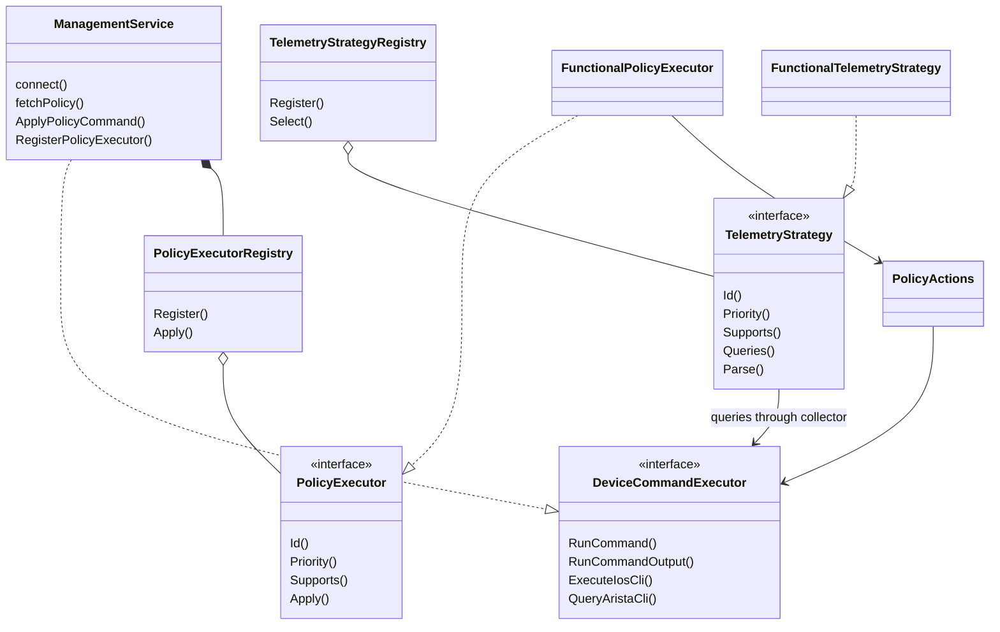
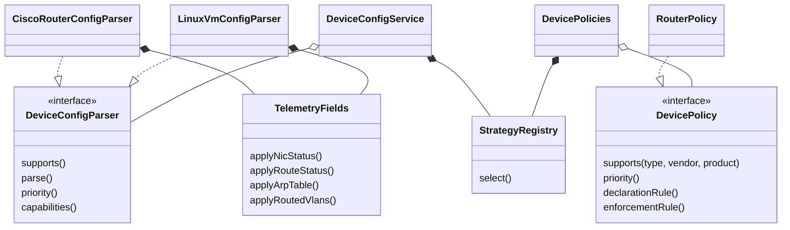
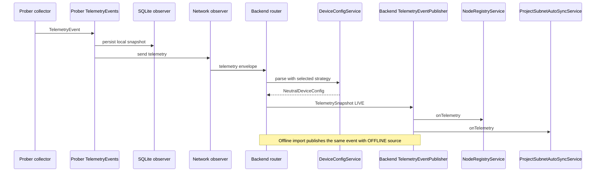

# 장비 확장 구조와 UML

장비 유형(Router/Switch/Firewall/VM)은 역할 분류이고, 벤더별 수집·변환·집행은 교체 가능한 전략입니다. 공통 구현 클래스를 상속하지 않고 작은 인터페이스와 변환기/명령 실행기의 구성으로 재사용합니다. ANTLR visitor, Spring/JPA의 필수 프레임워크 인터페이스는 해당 API 계약에 맞게 유지합니다.

## Prober의 장비 확장

`ManagementService`는 네트워크 연결·시간 제한·CLI 세션을 관리합니다. 장비별 정책 함수는 `PolicyActions`로 옮겼고 실행할 전략은 `PolicyExecutorRegistry`가 선택합니다. 동작이 있는 상위 클래스를 상속하는 대신 `DeviceCommandExecutor` 포트를 구성합니다. 새로운 정책 전략은 이 포트만 의존하므로 WebSocket 구현을 알아야 할 이유가 없습니다.

수집기는 장비별 조회 목록과 출력 해석기를 `TelemetryStrategy`로 등록합니다. `CollectState()`는 선택된 조회를 실행하고 선택된 파서로 결과를 변환합니다. Shell/IOS/FastCli는 전송 수단의 분기이며 장비별 긴 switch문은 없습니다. IOS 수집은 사용 가능한 EEM bridge의 새 CLI 결과를 우선하고, bridge가 없을 때 기존 snapshot/dohost 경로를 사용합니다.

- Prober의 구성 지점: `DefaultTelemetryStrategies()`, `DefaultPolicyExecutors()`.
- 실행 전 추가 등록: `TelemetryMonitor.RegisterStrategy()`, `ManagementService.RegisterPolicyExecutor()`.
- 단위 테스트/사용자 구성: 별도 registry를 만들어 `CollectState()`에 전달할 수 있습니다.
- 모호한 같은 우선순위나 미지원 전략은 명령을 실행하지 않습니다. 정책 ID 중복도 등록 오류입니다.
- `Nic`, `Port`는 상태를 공유하지 않는 `NetworkInterface` 인터페이스 구현입니다. 상태/동작이 없던 `PortInfo : Port`는 제거했습니다.

## Backend의 장비 확장

6개 변환기는 `DeviceConfigParser`를 직접 구현하고 `TelemetryFields`를 사용합니다. `AbstractDeviceConfigParser`는 제거했습니다. Cisco의 연결 경로 기반 prefix 보완, Arista VLAN/trunk, OVS 브리지, FRR/Linux/방화벽의 서브인터페이스 변환은 유지합니다. 반복하던 VLAN 서브인터페이스 변환은 공통 변환기 한 곳에 모았고 유효 VLAN 범위를 확인합니다.

| 변환 전략 | 기본 우선순위 | 담당 |
| --- | ---: | --- |
| CiscoRouterConfigParser | 100 | IOS 인터페이스·경로·ARP·prefix 보완 |
| AristaSwitchConfigParser | 100 | 인터페이스·경로·VLAN·trunk·ARP |
| OpenVSwitchConfigParser | 100 | OVS 브리지·포트·VLAN |
| FrrRouterConfigParser | 100 | FRR 경로·서브인터페이스 |
| AlpineFirewallConfigParser | 100 | nftables·서브인터페이스 |
| LinuxVmConfigParser | 0 | 일반 Linux |

새 변환기는 `@Component`로 등록하고 `DeviceConfigParser`를 구현합니다. 일반 Linux보다 구체적인 변환기는 높은 우선순위를 선언합니다. 같은 최고 우선순위가 둘이면 첫 등록/마지막 등록을 임의 선택하지 않습니다.

정책 컴파일러도 `DevicePolicy`로 등록합니다. `supports(type, vendor, product)`로 같은 Router 유형의 서로 다른 제품을 선택할 수 있습니다. 우선순위와 모호성 검사는 공통 `StrategyRegistry`를 사용합니다. 미지원 장비를 VM 정책으로 집행하는 폴백은 사용하지 않습니다. 타입이 없는 기본 선언은 기존 VM 기본값을 사용합니다.

## 텔레메트리 옵저버와 실행 순서

Prober의 SQLite 저장과 네트워크 전송은 동기 옵저버입니다. 별도 DB 스레드/큐를 되살리지 않았습니다. 실패한 옵저버 뒤에도 다음 옵저버가 실행됩니다. 사용자 옵저버는 `TelemetryMonitor.AddObserver()`로 실행 전에 등록합니다. 현재 실행은 main + 3개 worker입니다. 터미널 소켓과 PTY는 터미널 worker 하나가 소유합니다. 잠금과 종료 순서는 [Prober 수명 관리](prober-runtime.md)에 정리했습니다.

Backend의 LIVE/OFFLINE 입력은 동일한 `TelemetrySnapshot` 이벤트를 발행합니다. `NodeRegistryService`가 순서 100, `ProjectSubnetAutoSyncService`가 200으로 구독합니다. 새 후처리는 `TelemetryObserver` 구현 bean을 추가합니다. 각 트랜잭션은 구독자의 공개 `onTelemetry()` 경계에 유지하며 하나의 실패가 나머지 구독을 막지 않습니다. 설정 객체는 읽기 전용으로 취급해야 합니다.

## 파일 출력 계약

Prober는 `--export <file>`로 한 번 수집한 JSON 파일을 만듭니다. `ExportSnapshot(target, document)`만 실제 파일을 기록합니다. `BuildSnapshotDocument()`는 가져오기 스키마를 만드는 문서 조립 단계입니다. 표준출력·연속 export·사용하지 않는 재전송 큐 API는 제거했습니다. 자세한 마이그레이션은 [오프라인 파일 출력](../features/offline-export.md)에 있습니다.

## 검증과 확장 시 주의점

`DeviceExtensionTest`, `TelemetryObserverTest`와 C++ `device_strategies_test`는 공통 상위 구현 클래스 없이 새 전략을 등록하고, 등록 순서가 달라도 우선순위를 지키며, 모호한 정책은 명령을 실행하지 않고, 한 구독자의 예외가 다음 구독자를 막지 않는지 검사합니다.

전략 등록은 시작 단계에서 끝내고 처리 중에 바꾸지 않습니다. 동기 옵저버에서 오래 걸리는 작업을 추가하면 수집 주기가 늘어납니다. 새로운 장비 기능을 지원한다고 선언하기 전에 수집 출력 fixture·명령 생성 계약·미지원 오류를 함께 추가해야 합니다. 이 확장 구조가 [BDD의 실제 전달 경로 미지원 범위](../policy/bdd.md)를 해소하는 것은 아닙니다.

Arista CLI 조회와 제어는 [배치 실행·검증 계약](../features/arista-cli.md)을 사용합니다. 고정 300ms 읽기와 영구 FastCli PTY는 제거했습니다. 확장 구현은 `CliCommand` 대신 `QueryAristaCli` 또는 검증한 명령 묶음의 `RunCommand`를 사용합니다.

노드별 수집 주기는 [수집 설정](../features/node-monitor-settings.md)의 전용 telemetry 채널에서 동기화합니다. 이는 전략 등록·정책 관리 채널과 독립적입니다.
