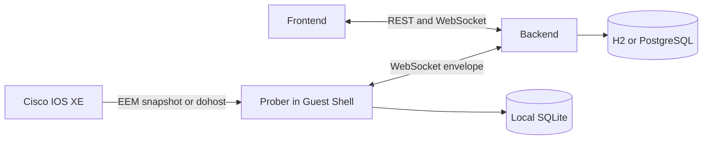

# 전체 아키텍처

Prober는 장비 명령 결과를 수집하고 구조화합니다. Backend는 장비 관측을 제공하고 프로젝트의 의도한 정책을 자체 BDD로 검사합니다. 실제 전달 경로 분석은 아직 구현되어 있지 않습니다. Frontend는 배포, 분류, 연결 편집, 검증 결과를 제공합니다.

관리망은 제어 채널입니다. 데이터망 정책을 바꾸더라도 관리 서버와의 연결을 유지해야 합니다. SSH 키는 설치와 수동 점검에 사용하고, Prober의 평상시 연결은 관리 서버 TCP 3000으로 나갑니다.

| 구성 | 현재 코드의 책임 |
| --- | --- |
| Prober components·module·database | 수집·파싱·통신·정책·로컬 SQLite |
| Backend Controller·Service·Repository·Policy | REST·세션·저장·BDD·장비 전략 |
| Frontend components·pages·context·lib/api | 화면·초안 상태·API 요청 |

[통신 계약](../protocol/overview.md), [DB 프로필](../deployment/database.md), [편집 흐름](../frontend/editor.md)을 각각 해당 기능의 기준 문서로 사용합니다.

수집된 상태와 저장한 정책은 별개입니다. 연결됨, 수집 성공, 검증 통과, 적용 성공을 각각 확인합니다. AI 조언은 검증 엔진의 판정을 대체하지 않습니다.

Prober의 현재 스레드·DB 이벤트·PTY 수명 관리는 [런타임 설계](prober-runtime.md)를 기준으로 합니다.

BDD는 Batfish의 아이디어를 참고한 자체 구현입니다. Batfish 직접 연동 여부, 현재 판정 범위와 남은 전달 모델은 [BDD 설계](../policy/bdd.md)를 기준으로 합니다.

장비별 구성·전략 선택·동기 옵저버의 현재 UML은 [장비 확장 설계](device-extensions.md)를 기준으로 합니다.
