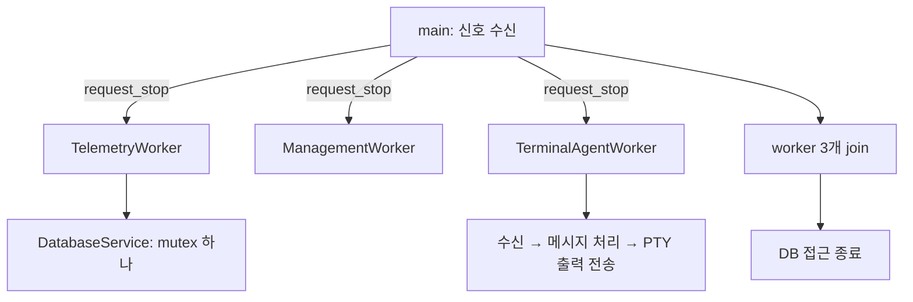

# Prober 실행과 수명 관리

## 작업 스레드

main은 신호를 받아 중지를 요청합니다. 수집·정책 관리·터미널 채널은 각각 하나의 jthread를 사용합니다. DB 전용 스레드·promise/future 작업 큐·추가 종료 감시 스레드는 없습니다.

터미널 작업 스레드는 WebSocket 수신 → 메시지 처리 → PTY 출력 전송을 한 루프에서 실행합니다. 재귀 콜백·전송 큐는 사용하지 않습니다. 셸 프로그램은 별도 프로세스가 필요합니다. 사용자 코드의 fork 후 C++ 할당 경로를 없애고 posix_spawn으로 실행합니다. 이는 셸 자체를 스레드로 실행한다는 의미가 아닙니다.

## 수집 완료 이벤트와 DB

수집 완료 시 PersistSnapshot이 저장 함수를 직접 호출합니다. DatabaseService는 같은 호출 스레드에서 작업을 실행하며 mutex로 SQLite 핸들을 직렬화합니다. 새로운 종류의 수집 이벤트는 telemetry_store의 저장 함수와 완료 이벤트 핸들러에 추가합니다.

저장 성공은 큐 등록 성공이 아니라 실제 커밋 성공입니다. 행 묶음마다 트랜잭션을 사용하고, BEGIN 실패 시 쓰지 않습니다. 행 실패·COMMIT 실패는 롤백합니다. SQLite busy timeout은 2초입니다. 여러 표 전체를 하나의 원자적 스냅샷으로 묶는 모델은 현재 구현하지 않습니다.

일반 종료는 생산 작업 스레드를 정지·join한 다음 DB를 닫습니다. 큐에 남는 비동기 쓰기가 없고, Close도 실행 중인 저장이 끝날 때까지 기다립니다. 성공을 가장한 _Exit(0) 강제 종료를 제거했습니다. 저장 장치 오류·SIGKILL까지 데이터 보존을 보장하는 설계는 아닙니다.

## 터미널 자원

셸마다 새 세션과 PTY를 만듭니다. 표준 입출력을 연결한 뒤 나머지 FD를 닫아 서버 소켓·DB 파일·EEM 실행 잠금이 셸에 상속되지 않게 합니다. EOF와 자식 셸의 waitid 상태를 함께 확인합니다. 셸이 먼저 종료되고 배경 작업이 PTY를 잡고 있어도 terminal-exit을 보내고 남은 작업을 정리·회수합니다.

브라우저 닫기·Agent 채널 단절·프로그램 중지는 같은 Close 경로를 사용합니다. job control로 분리된 전경·배경 프로세스 그룹도 같은 세션으로 찾아 종료합니다. TERM 후 최대 200ms를 기다리고 남은 프로세스에 KILL을 보내 직접 자식을 waitpid로 회수합니다. PTY는 nonblocking이며 입력 정체 대기는 최대 250ms입니다.

검증 원본: `SonarValidator_Prober/CMakeLists.txt`, `tests/robot/suites/lab_ui.robot`. [Linux posix_spawn 명세](https://man7.org/linux/man-pages/man3/posix_spawn.3.html)는 속성 적용 뒤 파일 작업을 실행하는 순서와 세션 생성 동작의 근거입니다.

현재 수집/정책 전략과 동기 옵저버 구성은 [장비 확장 UML](device-extensions.md)을 기준으로 합니다. 통신 서비스는 장비별 정책 구현을 상속하거나 소유하지 않고 명령 실행 포트와 전략 registry를 연결합니다.

## 동시성을 읽는 순서

복잡한 동기화 기법을 추가하기 전에 각 자원을 누가 소유하는지 확인합니다.

| 자원 | 소유자 | 다른 스레드와의 공유 |
| --- | --- | --- |
| 수집 WebSocket·수집 상태 | TelemetryWorker | 없음 |
| 정책 WebSocket·명령 세션 | ManagementWorker | 없음 |
| 터미널 WebSocket·PTY | TerminalAgentWorker | 없음 |
| SQLite 핸들 | main의 DatabaseService | mutex 하나로 Execute/Close 직렬화 |
| 시작 후 설정 | main | worker는 const 참조로 읽기만 함 |
| 중지 요청 | 각 jthread의 stop token | 표준 stop token으로 전달 |

main의 signal handler는 `sig_atomic_t` 플래그만 바꿉니다. main이 플래그를 확인해 세 worker 모두에게 먼저 중지를 요청하고, 그 다음 join합니다. 순서대로 중지·join하면 앞 worker를 기다리는 동안 뒤 worker는 계속 작업하므로 이 순서를 유지합니다.

### 왜 WebSocket 내부 비동기 호출은 남기는가

애플리케이션의 흐름은 위 순차 루프이며 Asio completion handler도 그 worker에서만 실행합니다. callback이 있다는 이유만으로 별도 스레드에서 실행되는 것은 아닙니다. 비동기 수신 하나를 유지해야 프레임이 여러 번에 나뉘어 도착해도 앞부분을 잃지 않고, 무응답 서버 때문에 종료를 무기한 기다리지 않습니다.

재접속은 진행 중 I/O 취소 → 완료 처리 → WebSocket 객체 교체 → 새 핸드셰이크 순서입니다. TCP 소켓만 닫고 기존 WebSocket을 다시 사용하면 이전 프로토콜 상태가 남으므로 `unique_ptr`로 연결 객체 하나의 수명을 명시합니다. 이 포인터를 다른 스레드에 공유하지 않습니다.

`TimedWebSocketReader`의 상태 객체는 취소 완료까지 버퍼를 살려 두는 용도입니다. 여기에는 mutex나 atomic이 필요하지 않습니다. `WriteWithTimeout`도 같은 io_context를 현재 worker에서 잠깐 실행하고 결과를 돌려줍니다. 한 번에 읽기 하나·쓰기 하나만 진행하며, 작업 스레드를 추가하거나 promise/future로 결과를 전달하지 않습니다. [Boost.Beast의 동시 읽기·쓰기 계약](https://www.boost.org/doc/libs/1_68_0/libs/beast/doc/html/beast/using_websocket/notes.html)을 따릅니다.

### 대기와 취소

TCP 연결·핸드셰이크·전송은 stop token과 제한 시간을 확인합니다. 재접속 대기는 `WaitForStop`의 짧은 sleep 반복으로 구현하고 최대 50ms 간격으로 종료를 확인합니다. 읽기 확인 간격은 터미널 20ms, 수집/정책 200ms입니다. 일반 sleep 재시도와 제어 흐름이 같아 별도 condition variable·barrier·종료 감시 스레드가 필요하지 않습니다. 이 값은 실시간 실행 보장이 아니며 OS 스케줄링, DNS 조회와 실제 명령 종료 시간이 더해질 수 있습니다.

## Backend WebSocket 잠금

서로 다른 HTTP/WebSocket 요청 스레드가 같은 장비 세션으로 응답과 push를 보낼 수 있습니다. 두 경로 모두 `AgentSessionRegistry.send`를 사용하고 `synchronized(session)` 하나로 직렬화합니다. 이전 SessionHolder 전용 잠금은 제거했습니다. 기존 전송 제한 decorator도 두 경로에서 같은 객체를 사용합니다. 세션 전체에 걸친 전역 잠금이나 별도 전송 스레드는 없습니다.

재접속 시 이전 세션 종료가 새 세션을 지우지 않도록 `remove(key, oldSession)`으로 자기 세션만 제거합니다. ConcurrentHashMap을 썼다고 그 안의 WebSocket까지 자동으로 thread-safe해지는 것은 아니므로 전송 잠금은 유지합니다.

검증은 `database_service_test`, `sigterm_shutdown_test`, `stop_wait_test`, `terminal_worker_test`, `websocket_timeout_test`, `websocket_reconnect_test`, `AgentSessionRegistryTest`와 실제 Lab1 Robot 종료/터미널 시나리오로 수행합니다.

노드별 수집 주기는 telemetry worker가 단독으로 관리합니다. SQLite 저장, 별도 수집 채널 등록, 현재 대기 재계산과 ACK 계약은 [수집 설정](../features/node-monitor-settings.md)에 있습니다. 사용하지 않던 외부 interval setter/atomic 필드는 제거했습니다.

## 로그

실행 로그는 시각과 작업 결과를 한 줄로 표시합니다. 반복 수집·정책 본문을 계속 출력하지 않으며 새 로깅 스레드는 없습니다. 출력 수준·요약 간격·경고 제한과 수동 조회 방법은 [작업 중심 로그](../development/logging.md)를 참고하세요.

## Cisco EEM 명령과 관리 수신

IOS에서 EEM bridge를 사용할 수 있으면 새 CLI 결과를 우선합니다. 요청은 공유 디렉터리의 작은 텍스트 파일이며 flock으로 직렬화하고, 고유 토큰과 응답 끝 표식이 맞아야 읽습니다. 지연된 이전 응답과 부분 기록을 현재 성공으로 취급하지 않습니다. watchdog EEM은 요청이 있을 때만 CLI 세션을 열고 종료 경로에서 닫습니다. 새 상주 프로세스나 터미널 전용 fork worker는 없습니다. bridge가 없을 때만 기존 EEM snapshot/dohost 폴백을 사용합니다.

정책 응답 대기 중 도착한 서버 COMMAND는 최대 32개인 관리 worker 내부 deque에 보관합니다. 응답 대기 함수가 네트워크 프레임을 읽고, 일반 처리 루프가 보관한 명령부터 꺼냅니다. 한 스레드가 두 경로를 모두 소유하므로 별도 잠금이나 condition variable은 필요하지 않습니다. 한도 초과는 경고하고 재접속 후 저장된 정책을 다시 조회합니다.
