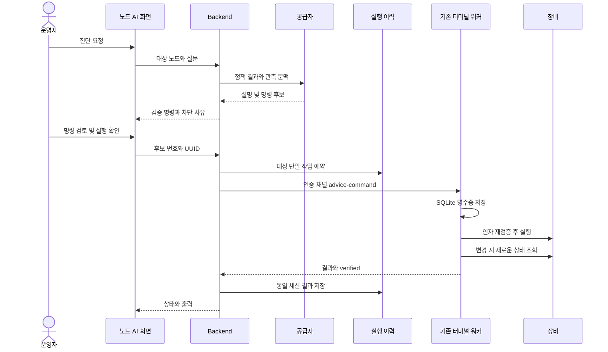

# AI 정책 진단과 명령 제안

정책 위반 화면의 AI 조언과 프로젝트 → 노드 설정 → **AI 진단·명령**에서 사용할 수 있습니다. 관리자·운영자가 오류 상황을 입력하면 서버가 다시 계산한 BDD 정책 결과와 수집된 인터페이스·VLAN·경로·수집 경고·최근 실행 오류를 함께 분석합니다.

BDD 범위는 `POLICY_HEADER_SPACE`입니다. AI 설명이나 BDD 통과가 실제 패킷 도달성 또는 장비 적용 성공을 의미하지 않습니다.

## 검토와 실행

1. 기존 AI 공급자 설정에서 연결을 등록합니다. 프로젝트 대역과 장비 설정 요약이 선택한 공급자로 전송됩니다. 키는 화면에 입력하며 기존 `SONAR_SECRET_KEY` 저장 계층으로 관리합니다.
2. 노드 AI 탭에서 질문하고 조언 이력을 확인합니다.
3. 검증된 실행 명령, AI 원문, 결과 확인 명령, 대상과 영향을 검토합니다.
4. **Prober 실행 검토** → 확인 체크 → **확인 후 Prober 실행**을 선택합니다. 관리자·운영자만 실행할 수 있습니다.
5. 전달·실행 중·결과 확인·실패·거부·확인 불가를 구분해 표시합니다. 설정 변경은 새로운 장비 조회로 확인해야 성공입니다.

실행 가능한 명령은 서버가 구조화된 유형과 인자로 생성합니다. Prober도 재검증합니다. AI 원문은 직접 실행하지 않으며 미지원 명령은 복사와 수동 검토만 제공합니다. 프로젝트나 장비 관측이 달라지면 새 조언이 필요합니다.

## 지원 작업

| 유형 | 장비 | 동작 |
| --- | --- | --- |
| `inspect_interfaces` | IOS, EOS, Linux/OVS | 인터페이스 조회 |
| `inspect_routes` | IOS, EOS, Linux/OVS | 경로 조회 |
| `inspect_vlans` | EOS, OVS | VLAN/Port 조회 |
| `set_interface_description` | IOS, EOS | 수집된 인터페이스 설명 변경 후 새로운 running-config 조회 |
| `ensure_vlan` | EOS | VLAN 생성·확인. 같은 설정은 재생성하지 않으며 기존 이름 충돌은 거부 |
| `block_forward_ipv4` | Linux nftables | 해당 노드 데이터 대역의 전달 차단. 전용 테이블 생성 후 JSON 규칙 확인 |

설정 변경은 실행 중인 설정에 반영됩니다. 부팅 설정 저장이나 방화벽 부팅 복원은 별도 관리 작업입니다. 전체 ACL 교체, Cisco 격리, 재부팅은 지원 목록에 없습니다. nftables는 관리 대역·관리 서버를 보호하며 다른 테이블을 지우지 않습니다. 자동 롤백을 보장하지 않으므로 실패·확인 불가 후 실제 상태를 조회한 뒤 판단하세요.

IOS 조회는 GuestShell dohost 제약으로 EEM 스냅샷을 사용할 수 있습니다. 출력에 이를 표시하며 Prober와 EEM의 갱신 주기는 별개입니다. 설정 변경 검증에는 스냅샷을 사용하지 않습니다. 새로운 호스트 조회가 불가능하면 적용 확인을 성공으로 표시하지 않습니다.

## 실행 구조



새 DB 스레드나 명령별 스레드를 만들지 않습니다. 기존 터미널 워커가 순서대로 처리하며 대화형 PTY와 동시에 실행하지 않습니다. AI HTTP 호출 동안 DB 트랜잭션을 유지하지 않고 예약과 상태 갱신만 짧게 처리합니다.

UUID로 중복 실행을 막습니다. Backend 재시작·단절 시 미확인 작업은 UNCONFIRMED로 남기며 자동 재전송하지 않습니다. Prober는 실행 전 영수증과 결과를 SQLite에 저장합니다. 180초 수락 기간의 영수증은 최대 64개까지 보관하며 가득 차면 새 실행을 거부합니다. OS 시간 동기화가 필요합니다.

기존 인증 터미널 채널과 공유 비밀값을 사용합니다. 프로젝트 전체 WebSocket 보안을 해결한 것은 아닙니다. 평문 WS·전역 공유 키와 다른 API 권한 문제는 [코드 리뷰](../development/code-review.md)의 별도 개선 항목입니다.

## API와 DB

- POST `/api/v1/policy/advice/{projectId}`: agent_id, provider_id, prompt
- GET 같은 경로에 `?agent_id=...`: 노드 조언 이력
- POST `/api/v1/policy/advice/{projectId}/{adviceId}/executions`: proposal_index, request_id(UUID), confirmed:true
- GET 실행 경로: 이력. 뒤에 executionId를 붙이면 개별 결과

사용자 요청에는 임의 명령 문자열을 받지 않습니다. 저장된 후보의 소속·권한·현재 관측 fingerprint·인자·온라인 기능·단일 실행 제약을 확인합니다. PostgreSQL 수동 변경문은 Backend의 `src/main/resources/db/manual-migrations/ai_advice_commands.sql`입니다. 로컬 H2는 기존 local 프로필 스키마 갱신을 사용합니다. DB 변경 전 백업이 필요합니다.

## 모의 공급자와 재현

Lab1 검증에는 루프백 HTTP 모의 공급자를 사용합니다. 응답은 [모의 공급자]로 표시하며 실제 AI 판단 품질 검증과 구분합니다.

```bash
node tests/robot/fixtures/ai-provider.mjs
# 별도 터미널에서 비밀번호 환경변수를 지정
SONAR_UI_PASSWORD=... tests/robot/run.sh lab1 demo ai
node --test tests/frontend/api-client.test.mjs
```

Robot AI 시나리오는 공급자를 임시 등록하고 종료 시 제거합니다. 실제 Lab1에서는 경로 조회만 실행하며 설명 변경은 미리보기, 미지원 reload는 서버 거부를 확인합니다. 실제 설정 변경 작업은 모의 장비를 사용하는 Backend·Native 테스트로 검증합니다.
