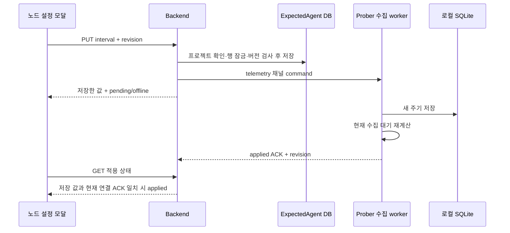

# 노드별 수집 주기

## 화면과 적용 상태

프로젝트의 노드 카드에서 **노드 설정**을 엽니다. 모달의 수집 설정 탭에서 값과 초·분·시간 단위를 입력합니다. 기본값은 30초이고 1초~24시간 범위의 정수 초를 지원합니다. 예를 들어 0.5분은 30초로 저장합니다. 연결 관리와 프로젝트에서 제거도 같은 모달에 두어 노드 카드의 버튼을 늘리지 않습니다.

저장한 주기와 Prober가 보고한 주기를 따로 표시합니다. HTTP 저장 성공·소켓 전달 성공은 Prober 적용 성공이 아닙니다. 적용 확인됨은 현재 수집 연결에서 받은 ACK가 저장된 값·설정 버전과 모두 일치한 경우입니다. 오프라인은 다음 연결 때 전달하고, Prober 저장 실패는 오류로 표시합니다.

이 설정은 Prober의 텔레메트리 수집 간격입니다. 프런트엔드 목록 새로고침과 정책 관리 요청 간격은 별개입니다. API 전용 장비의 별도 폴링 스케줄러를 설정하는 기능은 아닙니다. 특히 Cisco의 EEM 캐시 갱신 주기와 장비 응답 시간은 실제 원본 데이터의 시각에 영향을 줍니다.

## 저장·전달 흐름



관리 채널은 정책·격리 명령을 계속 담당합니다. 수집 채널은 별도 hello를 보내 등록하고 설정 변경을 받습니다. 수집 연결이 관리 세션을 덮어쓰지 않으며 이전 세션의 지연 ACK도 새 세션의 적용 상태를 바꾸지 못합니다.

## API와 프로토콜

등록된 노드에서 프로젝트 ID를 함께 사용합니다.

```text
GET /api/v1/agents/{agentId}/monitor-settings?project_id={projectId}
PUT /api/v1/agents/{agentId}/monitor-settings?project_id={projectId}
```

```json
{"monitor_interval_seconds": 10, "revision": 2}
```

값을 바꾸면 revision이 증가합니다. 같은 값의 재전달은 revision을 바꾸지 않습니다. 다른 편집자가 먼저 저장하면 409이며 값을 다시 불러와야 합니다. 누락·문자열·소수·범위 밖 값은 400, 다른 프로젝트/미등록 노드는 404입니다. API는 기존 세션 인증을 사용합니다.

수집 hello의 payload.channel은 telemetry입니다. 서버 hello ACK에는 monitor_settings 객체가 있고, 실시간 command의 action은 set-monitor-interval입니다. Prober ACK의 action은 monitor-interval-applied 또는 monitor-interval-rejected입니다. 버전이 지난 설정은 수집 주기를 되돌리지 못합니다. 수집 데이터에도 monitor_interval_seconds, monitor_revision, collected_at을 넣습니다.

## 재시작과 시간 의미

Backend는 ExpectedAgent의 monitor_interval_seconds/monitor_revision에 저장합니다. Prober는 SQLite settings의 monitor_interval_seconds에 저장합니다. 서버에 연결되지 않아도 캐시를 사용하고 수집 결과를 로컬 SQLite에 유지합니다. 재접속하면 서버의 저장 값이 우선합니다. 서버 등록을 다시 만든 경우도 새 연결에서 버전을 다시 동기화하므로 이전 캐시 버전에 갇히지 않습니다.

worker는 주기와 타이머를 단독 소유합니다. promise·조건 변수·새 설정 스레드를 추가하지 않았습니다. 짧아진 주기는 지금 대기에 반영하고, 길어진 주기는 이전 마감 시간을 미룹니다. 실행 중 수집은 중간에 끊거나 겹쳐 실행하지 않습니다. 수집·전송 완료 뒤 다음 수집까지의 대기 간격이므로 관측 주기는 실제 작업 시간만큼 길 수 있습니다. 첫 연결의 수집은 바로 수행합니다.

## DB 반영과 검증

local H2는 기존 ddl-auto update로 새 열을 추가합니다. PostgreSQL validate 환경은 배포 전에 `src/main/resources/db/manual-migrations/monitor_settings.sql`을 적용합니다. 기존 행은 30초·revision 0으로 시작합니다.

Backend 서비스·컨트롤러·JPA 재조회 검사, Prober의 결정적 타이머 검사와 실제 루프백 hello/명령/ACK/재시작 검사, Robot S11/S12로 검증합니다. 실제 Lab1에서 서로 다른 주기·재시작·원상복원을 확인합니다. Robot 실행 후 임시 프로젝트와 인증 상태를 정리합니다.
