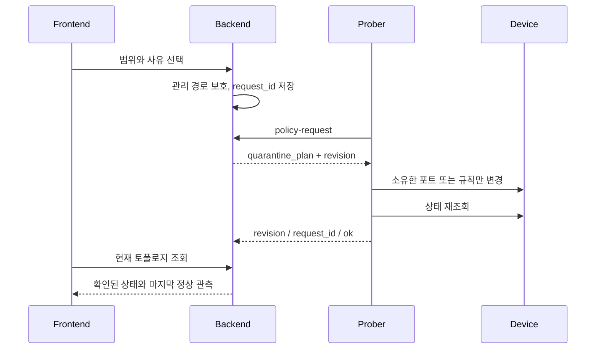

# 격리와 원상 복구

## 성공 판정

격리 요청의 저장, 장비 적용 확인, 실제 통신 차단은 서로 다른 단계입니다. HTTP 응답의 `request_id`는 작업 식별자이며 적용 성공을 뜻하지 않습니다. Backend는 현재 작업과 같은 revision / request_id의 ACK만 반영합니다.

| 상태 | 의미 | 화면 |
| --- | --- | --- |
| PENDING | 현재 요청의 장비 확인 대기 | 노란색, 격리/해제 확인 대기 |
| APPLIED | Prober가 장비 변경과 재조회를 완료 | 확인한 차단 상태를 빨간색으로 표시 |
| FAILED | 적용 또는 재조회 실패 | 주황색, 재시도 가능 |

해제 요청 후에도 장비 확인이 끝나기 전까지 마지막으로 확인한 차단 상태를 유지합니다. 실패한 해제는 목록에서 숨기지 않습니다. 재접속한 Prober는 저장된 `quarantine_plan`을 다시 조회합니다. 재부팅 초기의 무차단 시간을 없애는 fail-closed 설계를 보장하는 것은 아닙니다.

## 실행 흐름



예전의 비버전 COMMAND가 GuestShell의 Linux 포트를 내리던 경로는 거부합니다. 관리 worker의 순차 루프가 정책을 처리하며 격리 전용 스레드나 promise를 추가하지 않습니다.

## 장비별 지원 범위

| 장비 | 격리 방법 | 해제 방법 |
| --- | --- | --- |
| Cisco IOS XE | EEM CLI에서 대상 데이터 인터페이스 shutdown | 변경 전 admin 상태를 기록한 journal을 읽어 복원 |
| Arista EOS | FastCli 배치, 대상 Ethernet/VLAN 포트 shutdown | 원래 UP이었고 이번 작업이 변경한 포트만 복원 |
| OVS | 소유 cookie만 OpenFlow 1.4 bundle로 교체 | 해당 cookie만 제거 |
| Ubuntu | 전용 nftables inet 테이블과 관리 경로 예외 | 해당 테이블만 제거 |
| FRR Linux | 전용 iptables filter 체인, INPUT/FORWARD/OUTPUT의 첫 규칙 | 소유 점프와 체인만 제거 |
| API 전용 OPNsense | 직접 격리 요청 거부 | API 조회와 내부 Ubuntu 격리 검증은 별도 |

FRR은 `ip link down`을 사용하지 않습니다. 실제 Lab4 시험에서 포트를 내리면 커널에만 있던 기본 경로가 사라지고 `up`만으로 돌아오지 않는 문제를 발견했습니다. 전용 filter 체인은 경로·인터페이스·NAT 테이블을 바꾸지 않습니다. 이 경로의 보장 범위는 IPv4입니다. IPv6 전체 격리를 지원한다고 표시하지 않습니다.

관리 prefix와 서버 주소, Cisco VirtualPortGroup/Management 인터페이스를 보호합니다. 관리망과 겹치는 서브넷은 요청 단계에서 거부합니다. 원래 DOWN이던 포트를 임의로 올리지 않습니다. 운영자가 격리 중 동일한 포트/소유 규칙을 직접 수정하는 동시 작업은 피해야 합니다.

## 토폴로지 표시

인터페이스가 내려가면 마지막으로 정상 수집한 상태를 반영한 뒤 해당 경로 간선을 제거합니다. ACL/방화벽/OVS 격리에서는 링크 자체가 살아 있으므로 간선을 유지하고 차단 확인을 표시합니다. 두 동작을 같은 것으로 그리지 않습니다.

토폴로지는 프로젝트에 배정된 장비의 경로와 명시적으로 연결한 VLAN을 표현합니다. GNS3의 물리 배선도나 모든 방화벽을 통과하는 종단 간 도달성 모델이 아닙니다. 수집 실패 시 마지막 정상 값을 보존하되 오래된 관측과 오프라인 상태를 표시합니다. 미분류 등급은 Open으로 추정하지 않습니다.

Arista는 `show interfaces status | json`의 실제 포트 상태를 수집합니다. `Et1`과 `Ethernet1`은 수집 경계에서 같은 이름으로 정규화합니다. VLAN 멤버 문자열만으로 링크가 UP이라고 단정하지 않습니다.

## 재현 가능한 검증

`tests/robot/suites/isolation_topology.robot`은 실험별 격리 전/적용/해제 캡처와 원본 녹화를 남깁니다. 실제 데이터 ping 또는 HTTPS, 별도 관리 SSH, 현재 요청 ACK, 수집 인터페이스/경로, 자동 갱신된 SVG를 함께 검사합니다. 원상복구 실패 시 성공으로 바꾸지 않고 Lab을 남겨 진단합니다.

`quarantine_network_test`는 명시적으로 분리한 root 네트워크 namespace에서만 실행합니다. 이미 열려 있던 TCP와 새 연결 모두 차단하고 관리 연결을 보존하며, 반복 적용·해제 뒤 기존 경로와 filter/NAT 규칙 순서를 비교합니다. 일반 CTest에서는 권한이 없으면 SKIP입니다.

```bash
sudo unshare -n env SONAR_TEST_NETWORK_NAMESPACE=1 build/sonar_test_quarantine_network_test
```

Cisco EEM CLI 세션의 open/exec/close 계약은 [Cisco 공식 문서](https://www.cisco.com/c/en/us/td/docs/ios/ios_xe/netmgmt/configuration/guide/Convert/Emb_EventMgr_xe/nm_eem_policy_tcl_xe.html)를 따릅니다. 격리 기능과 일반 정책 ACL 생성/교체의 지원 범위는 같지 않습니다. 남은 일반 정책 문제는 [코드 리뷰](../development/code-review.md)를 확인합니다.
