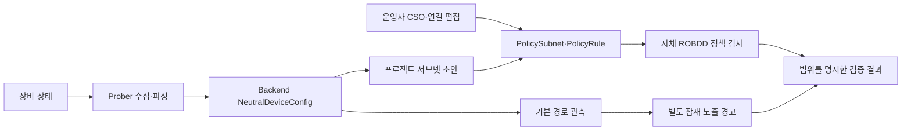

# BDD 정책 모델 검증

SonarValidator는 **Batfish의 모델 분리와 BDD 아이디어를 참고한 자체 구현**입니다. 현재 Backend/Prober에는 Batfish 서버·SDK·라이브러리를 호출하는 경로가 없습니다. `BddManager`, `BddNode`, `PacketVariables`, `SegmentationBddEngine`이 Backend에서 실행됩니다. Prober는 BDD를 계산하지 않습니다.

## 현재 데이터 흐름



Cisco EEM은 IOS 명령 결과를 GuestShell에 전달하는 수집 수단입니다. 현재 Lab1 EEM의 세 명령은 인터페이스 요약·라우팅·ARP입니다. 이 자료만으로 순서 있는 ACL, 인터페이스 ACL 바인딩, NAT, VRF, PBR을 복원할 수 없습니다. [Cisco 수집 계약](../deployment/cisco-eem.md)을 참조합니다.

`NeutralDeviceConfig`의 방화벽 규칙은 문자열 목록입니다. `ProjectView.discoveredRules()`는 이를 출발지/목적지가 없는 **비활성 검토 초안**으로 생성합니다. 실제 장비의 ACL을 의미가 보존된 BDD로 변환하는 기능은 구현되어 있지 않습니다. 자동 발견 서브넷의 CSO는 미분류 상태이며 운영자가 지정해야 합니다.

## 표현하는 패킷 공간

| 필드 | 비트 | 순서 |
| --- | ---: | --- |
| 출발지 IPv4 | 32 | 0–31 |
| 목적지 IPv4 | 32 | 32–63 |
| 목적지 포트 | 16 | 64–79 |
| IP 프로토콜 | 8 | 80–87 |

총 88비트입니다. IPv6, 출발지 포트, TCP 플래그, ICMP type/code, 세션 상태는 포함하지 않습니다. `tcp`, `udp`, `icmp`, `any`를 지원하며 빈 프로토콜은 TCP입니다. `ANY_PORT=-1`은 포트를 제한하지 않습니다. ICMP에 전송 계층 포트를 지정하면 입력 오류입니다.

`any`와 특정 포트를 조합하면 현 계약상 256개 프로토콜 값 전체에 그 포트 비트를 적용합니다. 따라서 `*_combinations`는 **이 추상 헤더 모델의 할당 수**이며 실제 유효 패킷 수, 호스트 수, 도달 가능한 연결 수가 아닙니다. `/24`는 네트워크/브로드캐스트를 포함한 256개 주소를 표현합니다.

## 검증 의미

활성 허용 규칙 r의 집합은 다음과 같습니다.

`H(r) = SrcCIDR(r) ∩ DstCIDR(r) ∩ DstPort(r) ∩ Protocol(r)`

- `A = ⋃ H(r)`: 입력된 활성 허용 규칙의 합집합
- `F`: Confidential ↔ Open 주소 쌍의 양방향 금지 집합
- `V = A ∩ F`: 정책 모델의 등급 모순 집합

`V`가 비어 있지 않으면 규칙별 교집합에서 대표 헤더를 추출합니다. 이 반례는 **허용 의도와 CSO 제약의 충돌**을 보여 주며 실제 장비를 통과한 패킷이나 홉별 경로 증거가 아닙니다. 중첩 대역의 상위 Sensitive 분류로 하위 Confidential 대역을 숨길 수 없습니다.

포트 미지정, `allowed_peers` 위반, 기본 경로 관측은 BDD 교집합 외의 별도 검사입니다. 그러므로 `violation_count`와 `violating_combinations`는 같은 대상을 세지 않습니다. 현재 규칙은 명시적 allow 집합이며 장비 ACL의 첫 일치 규칙·deny 우선순위·기본 동작을 표현하지 않습니다.

## API 결과와 배포 경계

`ProjectMapper`의 초안/저장 검증과 `/api/v1/policy/violations/{projectId}`는 다음 필드를 제공합니다.

| 필드 | 의미 |
| --- | --- |
| `analysis_scope=POLICY_HEADER_SPACE` | 입력된 정책 헤더 공간을 검사함 |
| `data_plane_analyzed=false` | 실제 전달 경로를 계산하지 않았음 |
| `model_valid` | 입력 구조·주소·분류·참조가 유효함 |
| `input_errors` | 모델을 완성하려면 수정해야 할 입력 |
| `compliant` | 모델 입력 오류와 현재 검사 항목의 지적이 모두 없음 |
| `evidence_type` | `POLICY_MODEL_FINDING` 또는 `DEFAULT_ROUTE_OBSERVATION` |

잘못된 CIDR, 누락된 CSO, 중복 서브넷/활성 규칙 ID, 빈 항목, 존재하지 않거나 모호한 규칙 참조, 잘못된 프로토콜/포트는 `model_valid=false`, `compliant=false`입니다. 중복 CIDR은 고유한 서브넷 ID로 참조해야 합니다. CIDR은 IPv4 리터럴만 허용하고 여러 `/`, 빈 접두사, 잘린 주소는 거부합니다. 기존 마지막 옥텟 `x` 표기는 0으로 해석하는 호환성을 유지합니다.

입력 오류는 `force=true`로 우회할 수 없습니다. 저장 시 빈 항목/중복 ID를 조용히 버리지 않고 HTTP 400으로 거부합니다. 자동 정책 요청도 같은 BDD 입력 검증을 수행하며, 입력 오류 모델은 `summary.source=invalid-project-model`, `model_valid=false`와 빈 `policies`로 응답합니다. 이 경로는 프로젝트 명령을 생성하지 않으며 운영자가 요청한 기존 격리 상태는 별도 처리됩니다. 정상 모델의 정책 지적에 대한 기존 강제 전송 기능은 유지됩니다. 빈 모델은 현재 제약에서 공집합으로 통과할 수 있으며, 네트워크가 검증되었다는 뜻은 아닙니다. 입력 오류가 있는 결과의 BDD 지표는 유효한 부분집합만을 나타냅니다.

기본 경로는 잠재 인터넷 노출 관측입니다. 기존 보수적인 검토 차단과 CSO별 심각도는 유지하지만, 기본 경로만으로 실제 도달성을 증명하지 않습니다. 이 관측에는 임의의 `1.1.1.1` 반례나 TCP 패킷을 만들지 않고 `sampled_packet=null`을 반환합니다. 관측이 없다고 인터넷 차단이 증명되는 것도 아닙니다.

## Batfish와의 차이

| 관점 | 현재 SonarValidator | Batfish 공식 설계 |
| --- | --- | --- |
| 주 입력 | 프로젝트 정책 + 일부 장비 관측 | 장비 설정 스냅샷과 토폴로지 |
| BDD 역할 | 허용 의도와 금지 집합의 교집합 | 전달 단계별 패킷 집합·변환 |
| 도달성 | 미구현 | 전달 그래프의 고정점 분석 |
| 경로·ARP | 화면/관측용으로 사용 | FIB·ARP와 전달 결과 계산 |
| NAT | BDD 변환 없음 | 변환 전후 필드 관계와 단계 연결 |
| 결과 | 정책 모델 지적·대표 헤더 | 전달 결과·흐름·경로 증거 |

비교 근거: Batfish의 [symbolic engine](https://github.com/batfish/batfish/blob/master/docs/symbolic_engine/README.md), [forwarding analysis](https://github.com/batfish/batfish/blob/master/docs/forwarding_analysis/README.md). 지원되지 않는 장비 기능까지 Batfish가 분석한다고 가정하면 안 되며, 실제 연동 시 버전과 파싱 지원 범위를 고정해야 합니다.

## 남은 설계 과제

1. **라우팅 도메인 식별**: 현재 전역 IPv4 공간에는 장비/VRF/테넌트 차원이 없습니다. 서로 격리된 VRF의 동일 IP 대역을 합치면 오탐이 생길 수 있습니다. 프로젝트를 단일 주소 도메인으로 제한하고, 확장 시 `(device, vrf, interface)`를 전달 상태 키로 삼아야 합니다.
2. **스냅샷 완전성**: 수집 시각·스냅샷 ID·명령 성공/실패·원문 해시·누락 기능을 묶어야 합니다. 현재 EEM 파일별 원자적 교체는 세 명령이 동일 시점이라는 보장이 아닙니다. 수집 누락이나 오래된 관측을 도달성 PASS로 처리하면 안 됩니다.
3. **전달 의미**: 순서 있는 permit/deny ACL과 인터페이스 바인딩, longest-prefix 경로 선택, NAT 전후 주소, PBR, VRF, 방화벽 상태를 분석기에 전달해야 합니다. 수집 문자열의 합집합으로 대체할 수 없습니다.
4. **결과 상태**: 실제 도달성 분석을 추가할 때는 `PASS / FAIL / UNKNOWN / ERROR`를 독립적으로 둡니다. 지원되지 않는 기능·불완전한 스냅샷·타임아웃은 UNKNOWN/ERROR이며 정책 준수로 승격하지 않습니다.
5. **실행 비용**: 요청별 manager로 BDD 노드를 격리하지만 노드/캐시 크기·시간·동시 요청 수의 상한은 아직 없습니다. 대규모 성능 검증과 취소/예산을 추가해야 합니다. 현재 정확성 테스트가 규모별 성능을 보장하지 않습니다.

6. **검증과 집행기의 의미 통합**: 자동 집행기의 `PolicyRegistryService.connectionsOf()`는 규칙 양 끝의 등급/허용 목록을 직접 판정합니다. BDD의 전역 주소 중첩 검사와 동일한 중간 표현을 공유하지 않습니다. 예를 들어 상위 Sensitive 대역과 하위 Confidential 대역이 중첩할 때, BDD의 지적과 전체 규칙 단위 집행 결과가 달라질 수 있습니다. 입력 오류 차단을 추가했다고 모든 BDD 제약이 자동 집행에 반영되는 것은 아닙니다. 검증된 중간 표현과 규칙 버전/해시를 컴파일·적용 확인까지 공유해야 합니다.

확장 방향은 Prober에 Batfish를 넣는 방식보다, **Prober의 버전 있는 원문 수집 → Backend 스냅샷 저장 → 별도 Batfish 분석 어댑터 → 정책 의도와 결과 비교**가 책임을 명확히 합니다. 이 구조는 제안이며 현재 Batfish를 설치하거나 연동하지 않았습니다. OPNsense 등 장비별 지원 여부를 먼저 검증하고 미지원 기능을 결과에 명시해야 합니다.

## 검증 코드

Backend 테스트 `BddCorrectnessTest`는 3변수 함수 256개, 함수 쌍 65,536개의 AND/OR/XOR, 각 변수의 존재/전칭 양화, support, 만족 할당 수와 대표 할당을 진리표와 대조합니다. 별도 테스트가 비루트 양화, 동일 변수의 다른 노드 방문, manager 간 노드 혼용, 부분 포트/프로토콜 할당, 잘못된 주소, 입력 오류의 강제 배포 차단을 검증합니다.

```bash
cd SonarValidator_Backend
./mvnw test -Dtest=BddManagerTest,BddCorrectnessTest,BddInputValidationTest,SegmentationBddEngineTest,PolicyModelPushGuardTest
```

[정책 모델](overview.md), [장비 적용 계약](device-contracts.md), [전체 아키텍처](../architecture/overview.md)를 함께 확인합니다.
